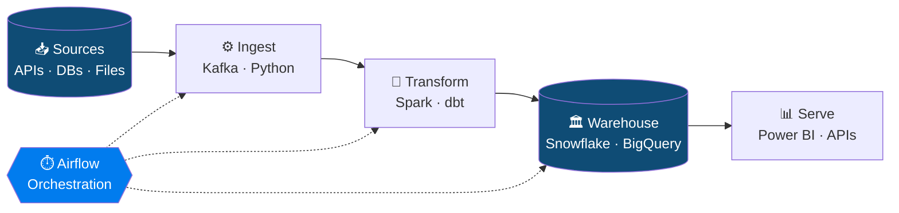

<!-- ============================================================
  SETUP
  1. Create a PUBLIC repo named exactly your GitHub username
     (e.g. github.com/janedoe/janedoe) and tick "Add a README".
  2. Paste this file in as README.md.
  3. Find & replace: YOUR_USERNAME, YOUR NAME, and every [BRACKET].
  4. Only keep projects you have actually built. Recruiters click.
  ============================================================ -->

<div align="center">


<a href="https://git.io/typing-svg">
  
</a>

<br/><br/>


</div>

---

## 👋 About Me

```sql
SELECT
    'YOUR NAME'                          AS name,
    'B.Tech [Branch], [College]'         AS education,
    '3rd year → 4th year (Batch 2027)'   AS year,
    'Data Engineer'                      AS career_goal,
    ['Python', 'SQL', 'Spark', 'Airflow'] AS core_stack,
    'Designing reliable, scalable data pipelines' AS passion
FROM me
WHERE coffee > 0
  AND curiosity = 'infinite';
```

- 🎯 **Goal:** land a Data Engineering internship / full-time role by 2027
- 🔭 **Building:** [Your current project, e.g. "a real-time streaming pipeline with Kafka + Spark"]
- 🌱 **Learning:** Apache Spark · Airflow · dbt · Kafka · Cloud (AWS / GCP / Azure)
- 🧩 **Practicing:** SQL & DSA on [LeetCode / HackerRank / StrataScratch]
- 💬 **Ask me about:** SQL optimization, ETL design, data modeling, Python for data

---

## 🧰 Data Engineering Toolkit

<div align="center">

| Layer | Tools |
|:------|:------|
| **Languages** |     |
| **Processing** |    |
| **Orchestration** |   |
| **Storage / Warehouse** |      |
| **Cloud** |    |
| **DevOps** |     |
| **BI / Viz** |    |

</div>

> 💡 *Delete any badge for a tool you haven't actually used. Honest skills beat a long list.*

---

## 🔄 How I Think About Data



---

## 🚀 Featured Projects

<!-- Replace each block with a REAL project. Ideas are in the "Project Roadmap" section below. -->

<table>
<tr>
<td width="50%" valign="top">

### 🏗️ [Project 1: Batch ETL Pipeline]
**Problem:** [e.g. Ingest daily e-commerce data from an API into a warehouse]

`Python` `Airflow` `PostgreSQL` `Docker`

- Orchestrated **[N] daily DAGs** with retries and alerting
- Processed **[X]M+ rows** with incremental loads
- Added data-quality checks (Great Expectations / custom tests)

🔗 [Code](https://github.com/YOUR_USERNAME/project-1) · [Architecture](#)

</td>
<td width="50%" valign="top">

### ⚡ [Project 2: Real-Time Streaming Pipeline]
**Problem:** [e.g. Stream live events and compute metrics in near real time]

`Kafka` `Spark Streaming` `MongoDB` `Docker`

- Handled **[X] events/sec** with a producer → consumer design
- Windowed aggregations with Spark Structured Streaming
- Live dashboard on top of the output store

🔗 [Code](https://github.com/YOUR_USERNAME/project-2) · [Architecture](#)

</td>
</tr>
<tr>
<td width="50%" valign="top">

### 🏛️ [Project 3: Cloud Data Warehouse + dbt]
**Problem:** [e.g. Model raw data into analytics-ready star schema]

`Snowflake / BigQuery` `dbt` `SQL` `GitHub Actions`

- Designed **fact & dimension** tables (star schema)
- **[N] dbt models** with tests and documentation
- CI pipeline runs tests on every pull request

🔗 [Code](https://github.com/YOUR_USERNAME/project-3) · [Docs](#)

</td>
<td width="50%" valign="top">

### 📈 [Project 4: End-to-End Data Platform]
**Problem:** [e.g. Raw → Bronze → Silver → Gold medallion lakehouse]

`AWS S3` `PySpark` `Glue / Athena` `Power BI`

- Built a **medallion architecture** data lake
- Partitioned Parquet for **[X]% faster** queries
- Published a BI dashboard for stakeholders

🔗 [Code](https://github.com/YOUR_USERNAME/project-4) · [Dashboard](#)

</td>
</tr>
</table>

<div align="center">

<a href="https://github.com/YOUR_USERNAME/project-1"></a>
<a href="https://github.com/YOUR_USERNAME/project-2"></a>

</div>

---

## 🗺️ Learning Roadmap: 3rd Year → 4th Year

| Status | Milestone | Target |
|:------:|:----------|:-------|
| ✅ | Python + SQL fundamentals (joins, window functions, CTEs) | Done |
| ✅ | Git & GitHub, Linux basics | Done |
| 🔄 | Build **Project 1**: Batch ETL with Airflow + Docker | [Month Year] |
| 🔄 | Apache Spark / PySpark (DataFrames, partitioning) | [Month Year] |
| ⏳ | Data modeling: star schema, normalization, SCDs | [Month Year] |
| ⏳ | dbt + a cloud warehouse (Snowflake / BigQuery) | [Month Year] |
| ⏳ | Kafka + streaming project | [Month Year] |
| ⏳ | Cloud certification (AWS DEA / Azure DP-203 / GCP PDE) | [Month Year] |
| ⏳ | Apply for DE internships & placements | [Month Year] |

<sub>✅ Done &nbsp; 🔄 In progress &nbsp; ⏳ Planned. Update this as you go; it shows momentum.</sub>

---

## 📊 GitHub Analytics

<div align="center">


<br/>


</div>

---

## 🏆 Achievements & Certifications

- 🎓 [Certification, e.g. Google Data Analytics / AWS Cloud Practitioner / Databricks Fundamentals], [Issuer], [Year]
- 🧠 [SQL practice: X+ problems on LeetCode / HackerRank / StrataScratch]
- 🥇 [Hackathon / competition], [rank], [Year]
- 🤝 [Open-source contribution / college club role]
- 💼 [Internship / freelance work if any], [one-line impact with a number]

---

## 📝 What I'm Writing

<!-- Even 2-3 short posts on what you learned will set you apart. -->
- [Post title: e.g. "Airflow DAGs explained simply"](https://your-link)
- [Post title: e.g. "Star schema vs snowflake schema"](https://your-link)

---

## 🤝 Let's Connect

<div align="center">

<a href="https://linkedin.com/in/YOUR_LINKEDIN"></a>
<a href="mailto:your.email@gmail.com"></a>
<a href="https://your-portfolio.com"></a>
<a href="https://www.kaggle.com/YOUR_KAGGLE"></a>
<a href="https://medium.com/@YOUR_HANDLE"></a>
<a href="https://your-resume-link"></a>

<br/><br/>

*"Without data, you're just another person with an opinion."* ⭐ Star a repo if you like my work!


</div>
